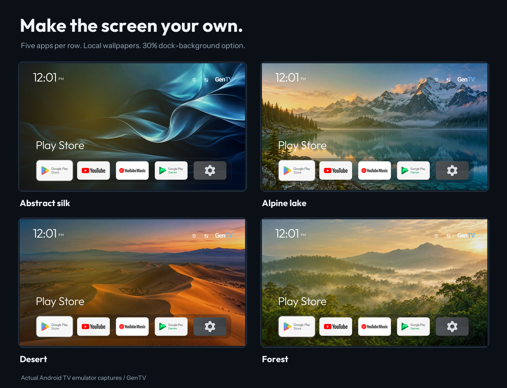
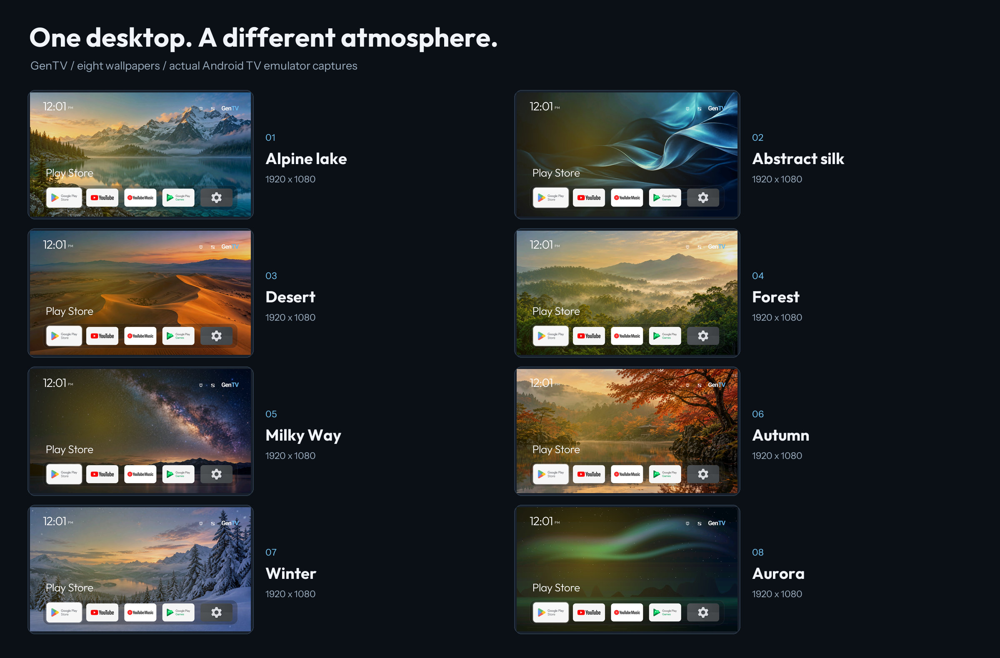
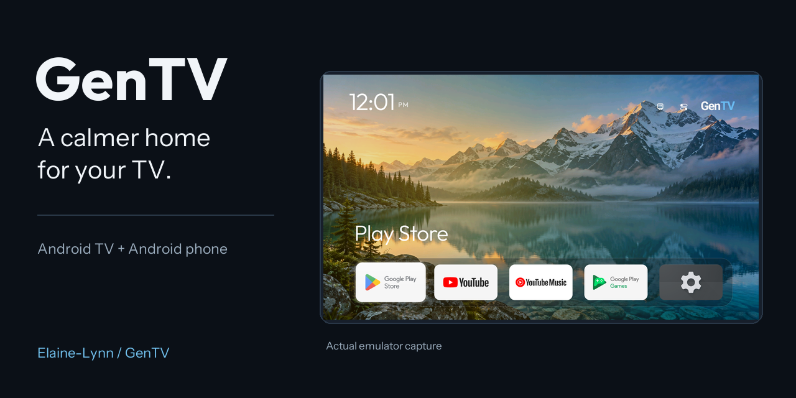

# GenTV

**A cleaner home screen. Less TV clutter. Fewer annoying ads. Easy to install.**

English · [简体中文](README.zh-CN.md)

[Download GenTV](https://www.gentv.me/) · [Get started](#get-started) · [Screenshots](#screenshots) · [Build from source](#build)


GenTV helps you tidy up your TV: switch to an **ad-free home screen**, use your phone to **clear storage and remove unwanted apps**, and enable optional DNS filtering to reduce distractions. Install with your phone, help from an AI assistant, or a USB drive.

**No account required · No root required · Free and open source**

## Four reasons to try GenTV

- **A clean, quiet home screen.** No promotions or ads in GenTV: just your apps, wallpapers and input shortcuts. Large tiles work with your remote, and the official TV release APK is under 600 KB.
- **Clear the clutter from your TV.** Inspect storage, clear cache, and review, disable or remove unwanted TV apps, all from your phone. Protected-package checks and recovery records support a backup-first workflow.
- **Fewer annoying ads.** The GenTV home screen is ad-free. Optional Private DNS filtering on supported TVs can reduce ad and tracker requests; results depend on the app and provider, and do not guarantee removal of boot ads or every in-app ad.
- **Install your way.** Connect and install from your phone, ask an AI assistant with local tool access to help, or open the TV APK from a USB drive. No root or firmware modification required.

The phone companion also provides remote controls, keyboard input, file transfer and desktop editing for everyday use.

## Get started

| Installation route | How it works |
|---|---|
| **Phone (recommended)** | Install GenTV Remote, connect to and authorise the TV, then select the GenTV installation action; keep using the phone for cleanup and remote control |
| **AI-assisted** | Give an assistant with local terminal access the repository URL and intended device; follow the [AI installation guide](docs/getting-started.md#install-with-an-ai-assistant) to check tools, build or choose an APK and install over ADB; approve device prompts yourself |
| **USB drive** | Copy the TV APK to a USB drive, open it in the TV file manager, and approve installation; see [USB instructions](docs/getting-started.md#install-the-tv-app-from-a-usb-drive) |

**To install from your phone:**

1. Install **GenTV Remote** on an Android phone from [gentv.me](https://www.gentv.me/).
2. Enable developer options and network/wireless debugging on the TV.
3. Open GenTV Remote, choose the TV and complete the pairing or authorisation prompts shown by the TV.
4. Use the phone remote, or select the GenTV installation action to try the new home screen. Choose a default Home separately in the TV's settings if you want to switch.

**Compatibility:** Android 8/API 26 or later on both devices. TV management requires reachable, authorised ADB access. Samsung Tizen and LG webOS do not run Android apps; manufacturer restrictions can also limit installation, Home replacement and input controls on Android devices.

For TV-only installation, CLI commands, source builds or an AI-assisted setup, use the [environment and installation guide](docs/getting-started.md).

## Screenshots

### A clean home screen for your TV




### TV maintenance and app management from your phone

Open storage cleanup, app management, recovery and ad-filter settings from the phone homepage. Review the TV state before choosing what to change.

- [Home and maintenance](docs/media/readme/screenshots/phone/01-home.png)
- [App management](docs/media/readme/screenshots/phone/04-app-management.png)

### All eight full-resolution TV screenshots



- [Alpine lake](docs/media/readme/screenshots/tv/01-alpine-lake.png)
- [Abstract silk](docs/media/readme/screenshots/tv/02-abstract-silk.png)
- [Desert](docs/media/readme/screenshots/tv/03-desert.png)
- [Forest](docs/media/readme/screenshots/tv/04-forest.png)
- [Milky Way](docs/media/readme/screenshots/tv/05-milky-way.png)
- [Autumn](docs/media/readme/screenshots/tv/06-autumn.png)
- [Winter](docs/media/readme/screenshots/tv/07-winter.png)
- [Aurora](docs/media/readme/screenshots/tv/08-aurora.png)

### All five phone interface previews

- [Home and maintenance](docs/media/readme/screenshots/phone/01-home.png)
- [Phone remote](docs/media/readme/screenshots/phone/02-remote.png)
- [Desktop management](docs/media/readme/screenshots/phone/03-desktop-management.png)
- [App management](docs/media/readme/screenshots/phone/04-app-management.png)
- [Welcome](docs/media/readme/screenshots/phone/05-welcome.png)

### View the repository promotional and sharing image



This image can also be selected in the GitHub repository Social preview settings.

TV images are actual Android TV emulator captures. Phone previews are UI-test renders with demonstration data. Promotional images compose those same interfaces. [All assets and source notes](docs/media/readme/README.md).

## More you can do

| Feature | What it provides |
|---|---|
| Desktop personalisation | Reorder, rename, group apps, choose custom tile pictures, and save or export a desktop profile |
| Wallpapers | Local pictures and optional online collections; downloaded images are cached for offline use |
| App maintenance | Community cleanup references for 252 device models, protected-package checks, backups and operation records; lists are references, not compatibility certification |
| Recovery | Re-enable disabled apps and restore eligible preinstalled packages removed for the TV user; fully uninstalled user apps need to be installed again |
| Ad filtering | Optional Private DNS filtering on supported Android 9+ TVs; effectiveness depends on the app and the DNS provider |
| Updates and privacy | Signed-package and SHA-256 checks; no GenTV account; anonymous usage statistics are off by default |

Source builds leave online services unconfigured. Official builds and self-hosted builds can enable them; see [online services](#online-services) and [Privacy](PRIVACY.md).

## Application IDs

| Component | Application ID | Source |
|---|---|---|
| GenTV TV | `com.gentv.tv` | `launcher/` |
| GenTV Remote | `com.gentv.mobile` | `phone/` |
| Remote debug build | `com.gentv.mobile.debug` | Isolated test installation |

## Build

No signing keys or server access are needed for development builds.

Run the commands below from the repository root.

TV: JDK 17, Android SDK 34 and build-tools 34.0.0.

```sh
./launcher/gradlew -p launcher --no-daemon testDebugUnitTest lintDebug assembleDebug
```

Phone: JDK 21 for Gradle, Android SDK 37, and JDK 25 for the ADB unit tests. Set `GENTV_HOME_JAVA_HOME` to a JDK 17 installation; the phone builds the TV app from this repository and embeds it. Without the private release key, the embedded TV app is debug-signed and is for local testing only. See the [phone instructions](phone/README.md).

```sh
./phone/gradlew -p phone --no-daemon :core:test :adb:test :app:testDebugUnitTest :app:lintDebug :app:assembleDebug
```

Repository checks:

```sh
python3 tools/check_branding.py
python3 tools/check_repository.py
python3 -m unittest discover -s server/wallpaper -p 'test_*.py'
```

### Online services

Updates, online wallpapers, feedback and anonymous statistics are off unless a GenTV API base is configured at build time. Builds from a fresh clone, including forks, never contact the official service. To point a build at a server you run:

```sh
./launcher/gradlew -p launcher -PgentvApiBaseUrl=https://api.example.com/tv/ assembleDebug
```

`GENTV_API_BASE_URL` works the same way. The [wallpaper service](server/wallpaper/README.md) contains the server side.

### Official releases

Official releases are signed with a private key that is never in Git, and release builds never fall back to a debug key. See [release and signing](docs/release.md). Standalone TV redistribution uses `launcher/app/build/outputs/distribution/GenTV-TV-release.zip`, which contains the APK and its licences; keep them together.

## Documentation

- [Pre-release validation and remaining acceptance](docs/pre-release-validation.md)
- [Implementation and validation](docs/implementation.md)
- [Desktop protocol](docs/desktop-protocol.md)
- [Release and signing](docs/release.md)
- [Development plan](docs/desktop-optimization-plan.md)
- [Module-card contract](docs/reference/modules.md)
- [Performance workflow](docs/reference/perf-ab.md) and [historical emulator measurements](docs/emulator-performance.md)
- [Wallpaper service](server/wallpaper/README.md)

## Project origins

GenTV began from three MIT-licensed open-source projects: a native Android TV home screen with community device lists, a phone ADB companion framework, and a TV home-screen installer whose install and undo patterns the framework adopted. Their names, links, baselines and licences are in [THIRD_PARTY_NOTICES.md](THIRD_PARTY_NOTICES.md). GenTV is independent of television manufacturers and third-party applications; their real names remain only where needed for operation and attribution.

## Use with care

Source builds and emulator tests do not certify real-TV Home behaviour, HDMI, physical remote keys or recovery. Installation does not authorise disabling the stock Home app. Keep backups, and turn off ADB debugging when maintenance is finished.

## Contact and licence

General reports: [GenTV issues](https://github.com/Elaine-Lynn/GenTV/issues). Sensitive reports: see [SECURITY.md](SECURITY.md).

GenTV is released under the [MIT License](LICENSE). Components from other projects keep their original copyrights and licences; see [THIRD_PARTY_NOTICES.md](THIRD_PARTY_NOTICES.md) and `licenses/`.
