<p align="center">
  <a href="https://www.gentv.me/">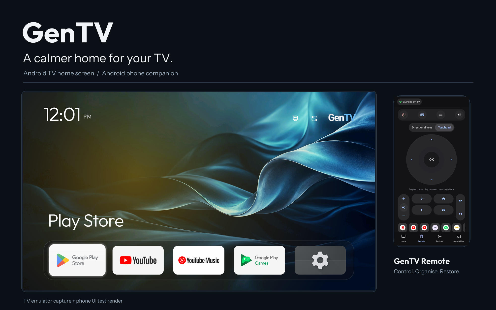</a>
</p>

<h1 align="center">GenTV — Ad-free Android TV launcher</h1>

<p align="center"><b>A clean home screen for your TV, managed from your phone. No computer, no root, no account.</b></p>

<p align="center">
  English · <a href="README.zh-CN.md">简体中文</a>
</p>

<p align="center">
  <a href="https://www.gentv.me/"></a>
  <a href="https://github.com/Elaine-Lynn/GenTV/releases/latest"></a>
  <a href="#install"></a>
  <a href="#faq"></a>
</p>

<p align="center">
  <a href="https://github.com/Elaine-Lynn/GenTV/releases/latest"></a>
  <a href="LICENSE"></a>
  
  
  
  
</p>

**GenTV is a free, open-source, ad-free launcher (home screen) for Android TV and Google TV, with a companion app for Android phones.** From the phone you can install GenTV on the TV, clean up preinstalled apps, clear storage, restore what you changed, and use the phone as a remote and keyboard. You don't need a computer, root access or a GenTV account.

| Traditional TV | GenTV |
|:---:|:---:|
| 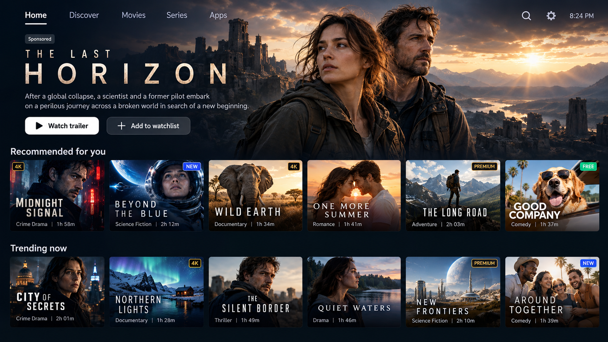 | 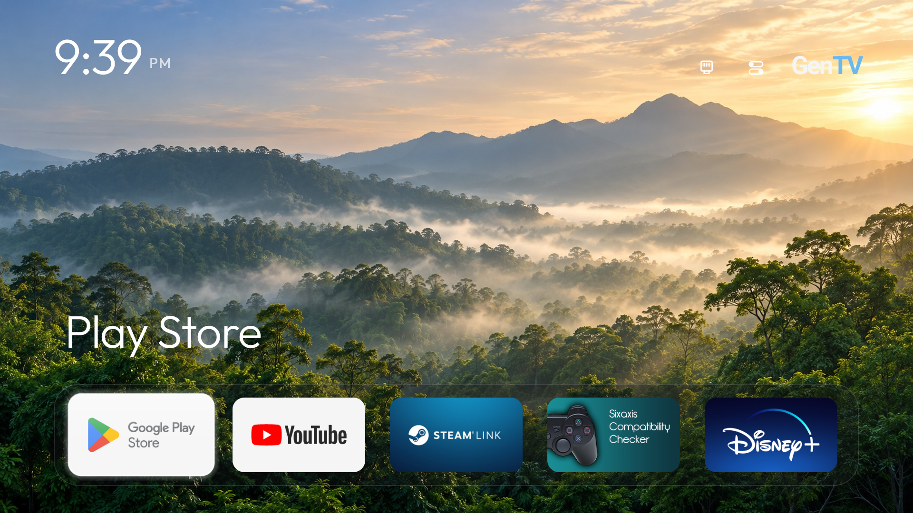 |

Official channels are only [gentv.me](https://www.gentv.me/) and this repository.

## Start here

| You have | Go to |
|---|---|
| **An Android TV or Google TV and an Android phone** | [Install from your phone](#install-from-your-phone): no computer needed |
| **A computer, or an AI assistant that can run commands** | [Install with an AI assistant](#install-with-an-ai-assistant) |
| **Only a USB drive** | [Install from a USB drive](#install-from-a-usb-drive) |
| **A Samsung (Tizen), LG (webOS) or Hisense VIDAA TV** | GenTV can't run there: [why](#does-it-work-on-samsung-lg-or-vidaa-tvs) |
| **You want to see it first** | [Screenshots](#screenshots) |

## Why GenTV

- **Everything from your phone.** Install GenTV, clean up the TV, use the remote and keyboard, send files and rearrange the home screen from an Android phone on the same network. You don't need a computer or a cable.
- **A home screen without ads.** GenTV shows no promotions, recommendation rows or ads. You see only your apps, wallpapers and input sources, on large tiles made for a remote. The official TV app is no larger than 1 MB, so it stays light on older TVs.
- **Clear out the clutter.** Check storage, clear caches, and review, disable or remove preinstalled apps you don't use. System components are protected, and every change is recorded.
- **Undo what you changed.** Re-enable disabled apps and restore eligible preinstalled apps from the phone.
- **Installed to be your home screen.** A full install makes GenTV the default Home once it opens and works with your remote. The previous Home is recorded first and the stock launcher is never uninstalled, so you can switch back. For China-market TVs, see the [FAQ](#default-home).

<a id="compare"></a>

## How GenTV differs from other ad-removal approaches

| | GenTV | Computer scripts | Guarded launchers |
|---|---|---|---|
| **You need** | An Android phone | A computer, usually with an AI coding assistant and the Android SDK | A computer or a USB drive |
| **Preinstalled app cleanup** | Pick apps to disable or remove on the phone, with restore | Disable a per-model list in bulk, restore with a script | Usually none |
| **Default Home** | Set to GenTV after it's verified, with the previous Home recorded for restore | Usually set as default, with the stock launcher disabled | Taken over with an accessibility service, so power-on and Home return to the new launcher |
| **Best for** | Doing the home screen, cleanup and remote without a computer | Command-line users who want a deep per-model cleanup | China-market TVs where booting straight into the new launcher matters most |

GenTV's TV home screen and device lists come from the computer-script approach (see [Project origins](#origins)). The difference is that installing, cleaning up and restoring all happen on the phone, and every change, including the Home switch, is recorded so it can be undone.

## Install

Both the TV and the phone need **Android 8.0 (API 26) or later**. Phone management needs the TV's ADB debugging switched on and authorised.

### Install from your phone

Recommended. You need an Android phone on the same Wi-Fi or local network as the TV.

1. Install **GenTV Remote** on the phone from [gentv.me](https://www.gentv.me/) or [GitHub Releases](https://github.com/Elaine-Lynn/GenTV/releases/latest) (`gentv-mobile-*.apk`).
2. On the TV, [turn on developer options and network or wireless debugging](#turn-on-adb-debugging-on-the-tv).
3. Open GenTV Remote, pick the TV and accept the pairing or debugging prompt on the TV.
4. Select **Install GenTV desktop**. GenTV opens on the TV.
5. Check that GenTV is on the TV and the remote moves around it, then tap **Yes, make GenTV my home screen**. The app records the current Home, switches to GenTV with the original launcher kept on, and checks the Home button. If the firmware sends Home back, it says so separately from the install and offers a compatibility step that turns off only what blocks the switch, never uninstalling it. **Just preview it, keep my home screen** installs GenTV without changing Home.

After that, keep using the phone for cleanup, the remote, the keyboard and home-screen editing.

### Install with an AI assistant

Use an assistant that can run commands on your computer, such as [Claude Code](https://claude.com/product/claude-code), [Codex](https://github.com/openai/codex) or [Gemini CLI](https://github.com/google-gemini/gemini-cli). Chat-only assistants can explain the steps but can't install anything. Copy this request to the assistant:

```text
Help me install GenTV from https://github.com/Elaine-Lynn/GenTV on my Android TV.
TV IP address: <TV IP>
Read docs/getting-started.md first, including "Instructions for an AI assistant".
Check my local tools, then use a compatible TV APK or build a Debug APK from source.
Install and open it over authorised ADB and verify the result.
Then make GenTV the default Home. Record the current Home first and keep the original launcher and my apps so I can switch back.
Remind me when I need to approve a prompt on the TV.
```

You approve the pairing and installation prompts on the TV yourself. Full steps are in the [installation guide](docs/getting-started.md#install-with-an-ai-assistant); rules for assistants are in [AGENTS.md](AGENTS.md).

### Install from a USB drive

Copy the **TV APK** (`gentv-tv-*.apk` from [GitHub Releases](https://github.com/Elaine-Lynn/GenTV/releases/latest), package `com.gentv.tv`, not the phone APK) to a USB drive, open it in the TV's file manager, and allow the installation. This route doesn't include phone cleanup or DNS filtering. Some TVs block USB installation. See the [USB steps](docs/getting-started.md#install-the-tv-app-from-a-usb-drive).

### Verify a download

Official releases are signed with one certificate, SHA-256 fingerprint:

```text
8D:5B:53:78:F9:05:68:80:F3:03:6D:44:BC:2F:4A:48:32:21:41:FB:B8:D8:BC:91:95:1D:61:A4:65:2D:99:7F
```

Each release also lists file checksums in `SHA256SUMS.txt`. The commands to check both are in [verify a download](docs/getting-started.md#verify-a-download).

### Turn on ADB debugging on the TV

| TV | Where to look |
|---|---|
| **Most Android TV / Google TV** (Sony, Philips, TCL Google TV, TV boxes) | Settings → System (or Device Preferences) → About → press **Android TV OS build** 7 times. Then open Developer options and turn on **USB debugging** and, if listed, **Network debugging** |
| **Android 11 or later with only "Wireless debugging"** | Developer options → Wireless debugging → **Pair device with pairing code**, and enter the code in GenTV Remote |
| **Xiaomi, Redmi, TCL, Hisense, Skyworth / Coocaa and other China-market TVs** | Menu names differ by brand and firmware; look for "ADB debugging" or "Developer options" under About or Security. Some firmware hides or removes it |

When the TV asks whether to allow debugging, choose **Always allow** from this device. Turn debugging off again when you're finished.

Brand-by-brand notes for Xiaomi, TCL, FFalcon, Sony, Hisense, Vidda, Skyworth, Coocaa, Philips, Google, Nvidia, Xgimi and Fire TV, each linked to the model it was recorded on: [turn on ADB, by brand](docs/devices/adb-by-brand.md).

## Screenshots

<p align="center">
  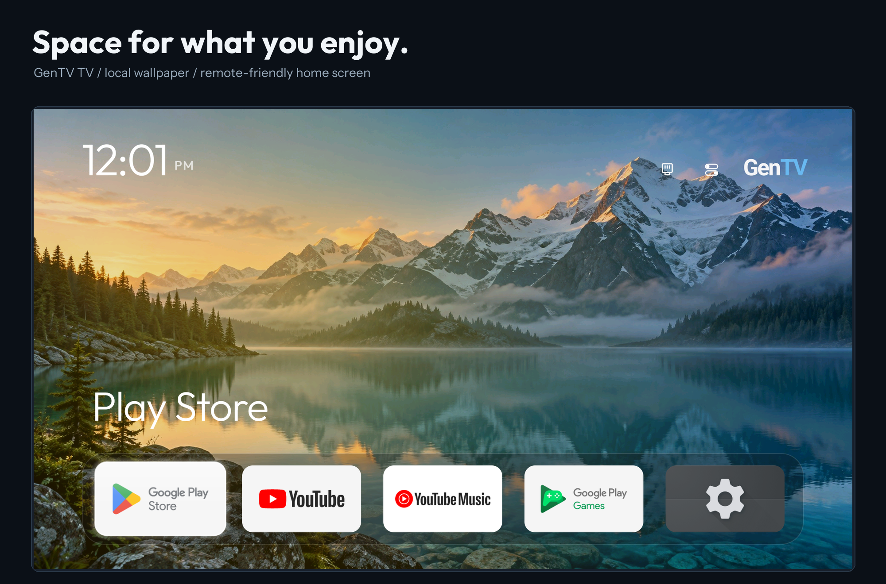
</p>

<p align="center">
  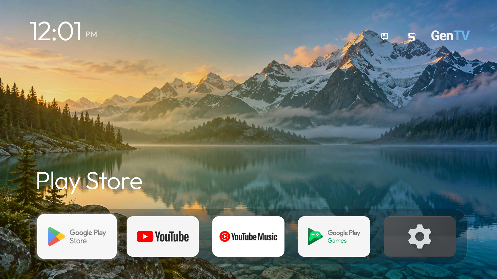
  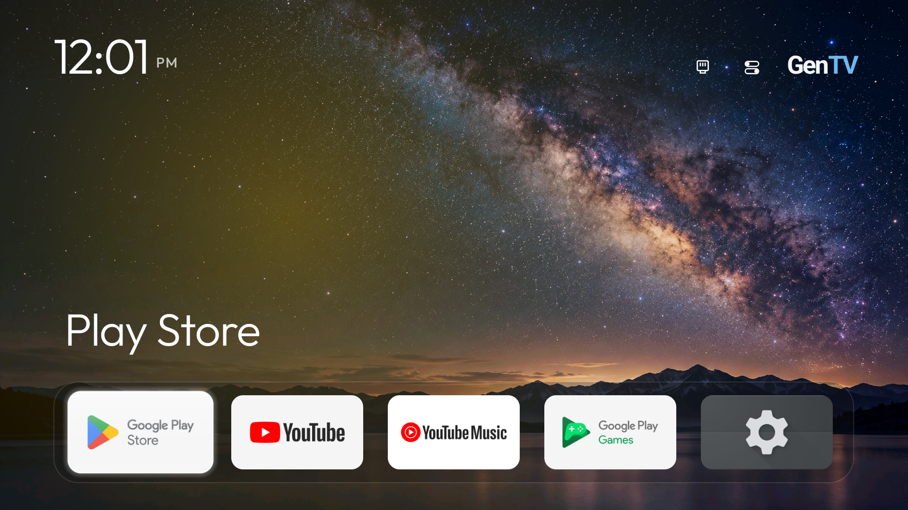
  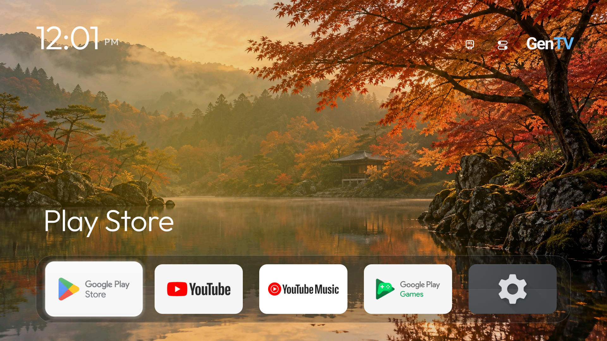
  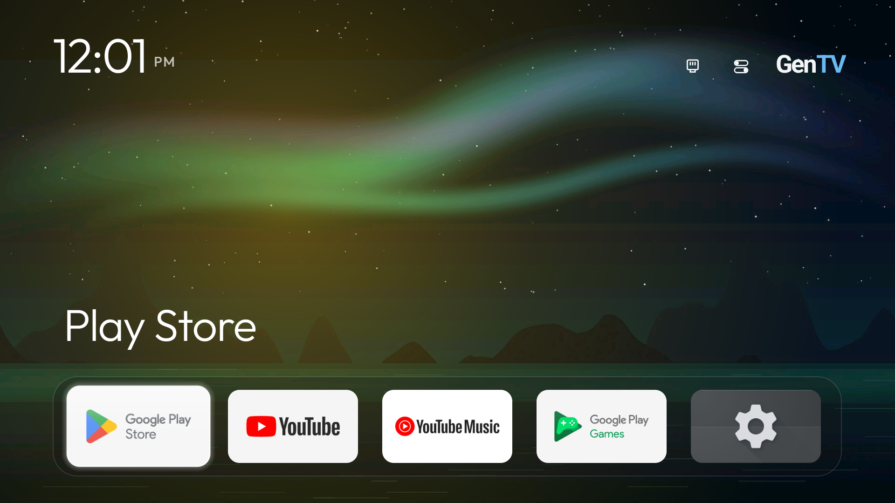
</p>

**Phone companion: maintenance, remote, home-screen editing and app management**

<p align="center">
  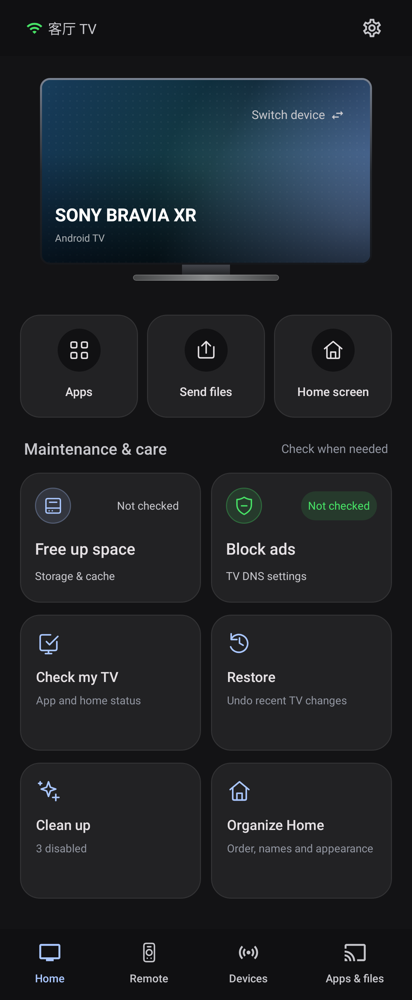
  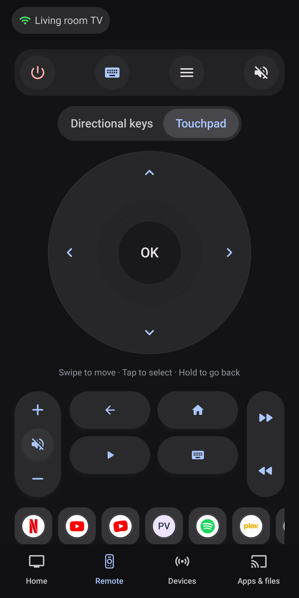
  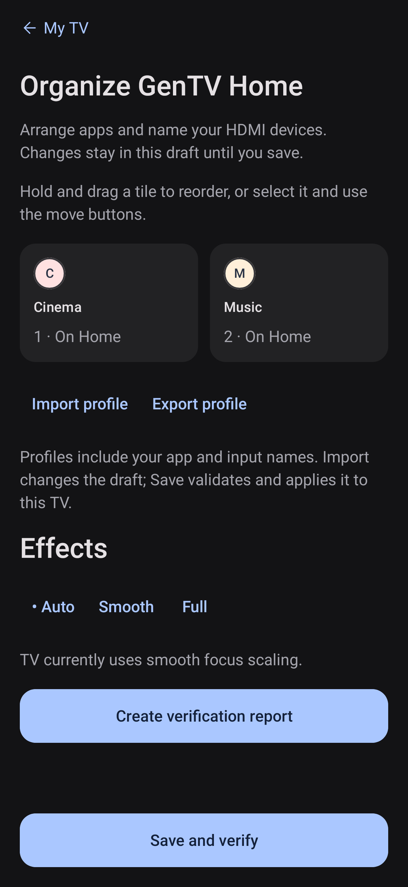
  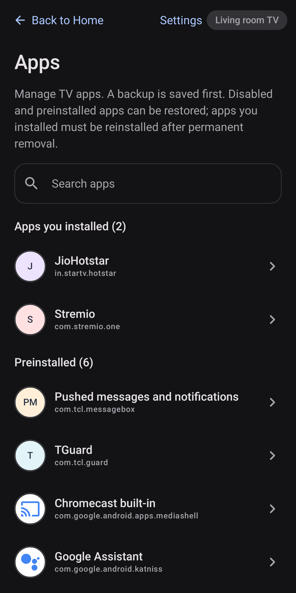
</p>

TV images are Android TV emulator captures. Phone images are UI-test renders with demonstration data. See [all eight wallpapers](docs/media/readme/overview/02-wallpaper-gallery.png) and [all images and source notes](docs/media/readme/README.md).

## Features

| Feature | What you get |
|---|---|
| Ad-free home screen | Dock and app grid, large tiles for remote navigation, input source shortcuts (including Skyworth / Coocaa sources), and an app library for everything installed |
| Folders and personalisation | Reorder, rename, hide and group apps into folders, choose tile pictures, and save, import or export a desktop profile, from the phone or the remote |
| Wallpapers | Local pictures and optional online collections; downloaded images are cached for offline use |
| Clock screensaver | A clock and date over a slow ambient glow; no network or images, light enough for a 1 GB TV |
| Dates and themes | Optional lunar (Chinese / Vietnamese / Korean) and Solar Hijri date lines, and seasonal festival themes; off by default |
| Phone remote | D-pad, touchpad, keyboard input and file transfer |
| Storage and app cleanup | Storage overview, cache cleanup, and reviewing, disabling or removing preinstalled apps, with protected-package checks, backups and operation records |
| Restore | Re-enable disabled apps and restore eligible preinstalled packages removed for the TV user |
| Ad filtering | Optional Private DNS setup on supported Android 9+ TVs to reduce ad and tracker requests |
| Game controllers | Optional controller passthrough, so games see the controller's buttons |
| Languages | TV interface translations for more than 25 languages |
| Updates and privacy | Signed-package and SHA-256 checks; no account; anonymous usage statistics off by default |

### What GenTV can and can't do

| Can | Can't |
|---|---|
| Replace the ad-filled home screen with an ad-free one once GenTV is the default Home | Remove boot ads, which the TV firmware plays before any home screen starts |
| Disable or remove preinstalled apps you pick, with records for undoing | Guarantee that every listed app is safe on your exact model; check before you change anything |
| Reduce ad and tracker requests with Private DNS on supported TVs | Block every in-app or video ad; results depend on the app and the DNS provider |
| Run on Android TV, Google TV, TV boxes and projectors with Android 8+ | Run on Samsung Tizen, LG webOS or Hisense VIDAA |

## Device references

The phone app includes community cleanup references for **252 TV, box and projector models**. The largest groups are TCL (57), Sony (32), Xiaomi (29), Philips (12), Hisense (10), Skyworth (8) and Amazon Fire TV (7). Models from Redmi, FFalcon, Vidda, Xgimi, Panasonic, OnePlus, Nvidia, Sharp and others are also covered. These lists come from the community. They help you decide what to clean up, but they don't certify that every feature works on your model. Home replacement, input switching and installation can still be limited by the manufacturer. Look up your model in the [device index](docs/devices/README.md).

## FAQ

### Can I install it without a computer?

Yes. Install GenTV Remote on an Android phone, pair it with the TV over the local network and install GenTV from the phone. A computer is only needed if you prefer the command line or want to build from source.

### Does it work with an iPhone?

Not yet. The phone companion is an Android app. With an iPhone, use the [AI assistant](#install-with-an-ai-assistant) or [USB drive](#install-from-a-usb-drive) route.

<a id="default-home"></a>

### Will GenTV become my default home screen?

Yes, that is what a full install is for. Once GenTV opens and works with your remote, the phone app or the [AI assistant route](#install-with-an-ai-assistant) sets it as the default Home and checks the Home button; the assistant also checks a reboot. The previous Home is recorded so you can switch back with Restore everything. With a USB install, choose GenTV in the TV's Home settings. If you only want to try GenTV first, say so and your current Home is kept.

Firmware on Xiaomi, TCL and other China-market TVs often has no such setting, or returns to the stock home screen at power-on or when you press Home. The phone app and the assistant route then continue with the staged handover in [TV care](docs/tv-care.md): it identifies the actual Home, may disable only what blocks the switch (never uninstalls it, and never touches Android or TV core services), and keeps an exact restore command. Accessibility helpers are only turned on if you choose them. If a firmware limit can't be lifted, you are told so and can still open GenTV from the app list. Don't disable the stock launcher by hand: on some TVs that can leave a black screen at boot that only ADB can fix.

### Could this break my TV? How do I undo changes?

GenTV doesn't root the TV or modify its firmware. Cleanup works on apps you choose; system components are protected, and each change is recorded. From the phone you can re-enable disabled apps and restore eligible preinstalled apps. A user app that was fully uninstalled has to be installed again. Back up first, and change a few apps at a time.

### Can it remove boot ads?

No. Boot ads are played by the TV firmware before any home screen starts. GenTV removes the ads on the home screen itself, and optional Private DNS filtering can reduce some ad requests in apps.

### Will my existing apps, subscriptions and voice assistant still work?

Installing GenTV doesn't uninstall anything. Your apps, accounts and the original home screen stay on the TV. Switching Home may disable only what blocks it, and that is recorded and can be restored; cleanup changes only the apps you select.

### Does it work on my TV?

GenTV is built for TVs, boxes and projectors running Android TV or Google TV 8.0 or later, for example from Sony, Philips, TCL, Xiaomi, Redmi, Hisense, Skyworth / Coocaa and Nvidia, and Chromecast with Google TV. Some firmware blocks installing apps, replacing Home or using input controls. See [device references](#device-references).

### Does it work on Samsung, LG or VIDAA TVs?

No. Samsung Tizen, LG webOS and Hisense VIDAA aren't Android and can't run Android apps.

### Does GenTV collect my data?

There's no GenTV account, and anonymous usage statistics are off by default. Builds from source never contact the official service. See [Privacy](PRIVACY.md).

### How do I uninstall GenTV?

Choose the original Home in the TV's settings and check that it opens. Export your desktop profile if you want to keep it, then uninstall GenTV from the TV's app settings. Turn off ADB debugging when you're done.

## For developers

| Component | Application ID | Source |
|---|---|---|
| GenTV TV | `com.gentv.tv` | `launcher/` |
| GenTV Remote | `com.gentv.mobile` | `phone/` |
| Remote debug build | `com.gentv.mobile.debug` | Isolated test installation |

Development builds don't need signing keys or server access, and builds from a fresh clone never contact the official service. Build commands, repository checks, self-hosted services, release signing and the full documentation list are in [CONTRIBUTING.md](CONTRIBUTING.md). Rules for coding assistants are in [AGENTS.md](AGENTS.md).

<a id="origins"></a>

## Project origins

GenTV began from three MIT-licensed open-source projects: a native Android TV home screen with community device lists, a phone ADB companion framework, and a TV home-screen installer whose install and undo patterns the framework adopted. Their names, links, baselines and licences are in [THIRD_PARTY_NOTICES.md](THIRD_PARTY_NOTICES.md). GenTV is independent of television manufacturers and third-party apps. Their names appear only where needed for operation and attribution.

**Why is the first public release v3.7.0?** Versions 3.0 to 3.6.x were distributed as debug-signed development builds before the source was opened. v3.7.0 is the first open-source release and the first signed with the release key. The commit history was consolidated when the repository opened, so it starts at this version. For upgrading from a development build, see [release and signing](docs/release.md).

## Use with care

Source builds and emulator tests don't certify real-TV Home behaviour, HDMI, physical remote keys or recovery. Switching Home never requires you to disable the stock Home app by hand. Keep backups, and turn off ADB debugging when maintenance is finished.

## Contact and licence

Questions and bug reports: [GitHub issues](https://github.com/Elaine-Lynn/GenTV/issues). Security reports: see [SECURITY.md](SECURITY.md).

GenTV is released under the [MIT License](LICENSE). Components from other projects keep their original copyrights and licences; see [THIRD_PARTY_NOTICES.md](THIRD_PARTY_NOTICES.md) and `licenses/`.
